# MathLive Plugin for Obsidian

MathLive helps you write math in Obsidian faster. Instead of manually typing every LaTeX command, you can open a visual math editor, build the expression you want, and insert it directly into your note.

It can also turn a copied formula image into LaTeX, either through a hosted OCR service or your own local OCR server.

[Visit the site](https://mathlive.danz.blog)

## Why Use It

- Write inline math and display math without leaving your note.
- Edit existing formulas in a visual math field instead of raw LaTeX only.
- Convert pasted formula images into LaTeX when you do not want to retype them.
- Stay inside Obsidian for everyday note-taking, class notes, and problem solving.

## What You Can Do

### Visual math editing

Use MathLive when you want to:

- insert new inline math like `$x^2 + y^2$`
- insert display math blocks like `$$\int_0^1 x^2 dx$$`
- tweak an existing expression in a friendlier editor

### Formula OCR

If you copy an image of a formula to your clipboard, MathLive can try to convert it into LaTeX and add it to the editor for you.

This is useful for:

- screenshots from PDFs or slides
- handwritten or typeset formulas you want to reuse
- getting a draft expression quickly before cleaning it up

## Installation

1. Open Obsidian.
2. Go to **Settings -> Community plugins**.
3. Click **Browse** and search for `MathLive`.
4. Click **Install**.
5. Click **Enable**.

## Getting Started

### Insert or edit math

1. Open any note.
2. Open the command palette with `Ctrl/Cmd + P`.
3. Run `Add inline math` or `Add full-line math`.
4. Type in the MathLive editor and click `Insert into note` (or press `Ctrl/Cmd + Enter`).

If you already selected text first, MathLive uses that selection as the starting content, which makes editing existing formulas quicker.

### Set a hotkey

If you use math often, assign a hotkey to the MathLive commands in **Settings -> Hotkeys**. That makes the plugin much faster to use during note-taking.

## OCR Setup

MathLive supports two OCR modes.

### Cloud OCR

Best for most users. No local setup required.

1. Create a free account and API key at [mathlive.danz.blog](https://mathlive.danz.blog). Free accounts include 10 scans; unlimited scanning is a paid plan.
2. Open **Settings -> MathLive**.
3. Paste the key into `API key`.
4. Make sure `Self-hosted scanner` is turned off.

### Self-hosted OCR

Best if you want to run OCR on your own machine.

1. Set up a compatible OCR server such as [LaTeX-OCR](https://github.com/lukas-blecher/LaTeX-OCR) so it is available at `http://localhost:8502`.
2. Open **Settings -> MathLive**.
3. Turn on `Self-hosted scanner`.

Self-hosting is more technical and usually only makes sense if you are already comfortable running local services.

## How To Scan A Formula Image

1. Copy a formula image to your clipboard.
2. Open MathLive with `Add inline math` or `Add full-line math`.
3. Click `Add LaTeX from clipboard image`, or use the image button on a math widget in your note.
4. Wait for the recognized LaTeX to appear in the editor.
5. Clean up anything that needs correction, then click `Insert`.

## Notes

- `MathLive` is desktop-only.
- OCR results are a starting point, not a guarantee. You may still want to fix symbols or spacing.
- Cloud OCR is usually the simplest option if you just want the feature to work.

## Disclosures

Obsidian asks plugins to state the following up front.

- **Payment.** The visual editor is free. Cloud scanning includes 10 free scans per account; unlimited scanning requires a paid plan from [mathlive.danz.blog](https://mathlive.danz.blog). Self-hosted scanning is free.
- **Account.** Cloud scanning requires a MathLive account (sign-in with Google) and an API key. The editor and self-hosted scanning need no account.
- **Network use.** The plugin only connects to the internet for cloud scanning:
  - `https://mathlive-ocr.danz.blog/predict/` receives the image you chose to scan, with your API key, and returns LaTeX.
  - `https://mathlive-ocr.danz.blog/access-status` is checked with your API key to show whether your account has unlimited scans.
  - With `Self-hosted scanner` on, scans go to `http://localhost:8502` instead, and nothing leaves your computer.
- **Clipboard.** The plugin reads your clipboard only when you click a scan button, to get the image you copied.
- **Data.** The scan server turns the image into LaTeX and does not keep the image. Your account stores your email, your API keys, your scan count and when a key was last used. Server logs record requests and errors to keep the service running.
- **No telemetry, ads or pop-ups.** The plugin does not track how you use it and shows no ads.

## Contributing and security

See [CONTRIBUTING.md](CONTRIBUTING.md) to report a bug, suggest a feature or send a pull request, and [SECURITY.md](SECURITY.md) to report a security issue privately.

## Support

Issues and feature requests: [github.com/danzilberdan/obsidian-mathlive](https://github.com/danzilberdan/obsidian-mathlive)

## Acknowledgements

- [MathLive](https://github.com/arnog/mathlive) for the visual editor
- [LaTeX-OCR](https://github.com/lukas-blecher/LaTeX-OCR) for OCR support
